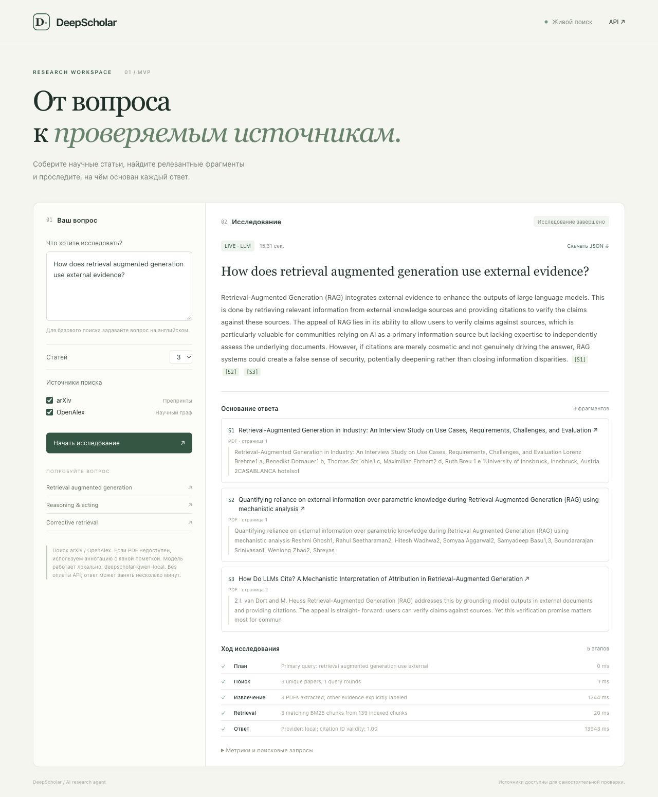

# DeepScholar

[](https://github.com/egorryabushko/deepscholar/actions/workflows/ci.yml)

A research workflow over **arXiv and OpenAlex** with inspectable evidence, page citations,
a FastAPI API and a small browser UI. Portfolio MVP for an LLM / AI Engineer role.

> Current scope: a bounded deterministic research workflow and BM25 retrieval baseline.
> The default demo uses author-written notes and extractive excerpts; it does not run an LLM.
> Hugging Face and locally served open-weight models are configurable adapters.
> Citation ID validation does not establish factual support or entailment.



## Run the first end-to-end demo

Python 3.11–3.13:

```bash
python -m venv .venv
source .venv/bin/activate
pip install -e ".[dev]"
uvicorn deepscholar.app:app --host 127.0.0.1 --port 8000
```

Open <http://127.0.0.1:8000>. Use the sample question:
**How does retrieval augmented generation use external evidence?**

The default configuration is offline and reproducible. It returns a labeled demo result
with evidence cards, source links, metrics and a trace. Try an unrelated question to see
the insufficient-evidence path. OpenAPI: <http://127.0.0.1:8000/docs>.

```bash
curl -s http://127.0.0.1:8000/api/research \
  -H 'Content-Type: application/json' \
  -d '{"question":"How does retrieval augmented generation use external evidence?","max_papers":3}'
```

## Live scholarly search

Copy `.env.example` to `.env` and set `DEEPSCHOLAR_OFFLINE=false`.
An OpenAlex API key is optional for basic requests and recommended for predictable quota.
arXiv does not require a key. Search works in English; Russian questions are not translated
by the deterministic planner.

Run an explicit live metadata/PDF smoke check (no model inference):

```bash
python -m deepscholar.smoke_live
```

PDFs are downloaded only from the exact HTTPS hosts in `DEEPSCHOLAR_PDF_HOSTS`.
Default: `arxiv.org`, `export.arxiv.org`. OpenAlex often returns publisher PDF URLs;
unlisted hosts are skipped with an explicit warning and the abstract becomes the evidence.
Add specific trusted scholarly hosts as needed. Never use a wildcard allowlist.

## Configure an open-weight LLM

### Hugging Face Inference Providers

```dotenv
DEEPSCHOLAR_LLM_PROVIDER=huggingface
DEEPSCHOLAR_HF_TOKEN=your_token
DEEPSCHOLAR_HF_MODEL=Qwen/Qwen2.5-7B-Instruct
DEEPSCHOLAR_HF_PROVIDER=auto
```

The model ID is an example, not a claim that this model is currently served by your chosen
provider. Select a chat model available to your account. Authentication, provider availability,
quota and billing are external requirements. No remote inference runs by default.

### Local OpenAI-compatible server

Serve an open-weight model with Ollama, vLLM, llama.cpp or TGI, then configure its model name:

```dotenv
DEEPSCHOLAR_LLM_PROVIDER=local
DEEPSCHOLAR_LLM_BASE_URL=http://localhost:11434/v1
DEEPSCHOLAR_LLM_MODEL=qwen2.5:7b
```

`DEEPSCHOLAR_LLM_API_KEY` is optional for a protected endpoint. The model server is managed
separately; this repository does not download weights automatically. From Docker Desktop,
use `http://host.docker.internal:11434/v1` to reach a host model server.

### No paid API: low-memory CPU profile

For Intel Macs or other CPU-only machines, start with a small instruction model.
The official [Qwen2.5-1.5B-Instruct GGUF](https://huggingface.co/Qwen/Qwen2.5-1.5B-Instruct-GGUF)
Q4_K_M file is about 1.12 GB. This is a resource-conscious baseline, not a claim that
a 1.5B model matches larger models in research quality. CPU generation may take minutes.

Download a compatible [llama.cpp release](https://github.com/ggml-org/llama.cpp/releases)
and the GGUF weights, then run two terminals:

```bash
# Terminal 1: serve already-downloaded weights (no cloud inference).
bash scripts/serve-local.sh /path/to/llama-server /path/to/qwen2.5-1.5b-instruct-q4_k_m.gguf

# Terminal 2: copy profiles/local-cpu.env.example to .env after reviewing any existing .env.
uvicorn deepscholar.app:app --host 127.0.0.1 --port 8000
```

The profile uses a 4,096-token server context, three evidence chunks, 350 output tokens,
and a longer request deadline. The browser follows the configured deadline.
`DEEPSCHOLAR_LLM_MODEL` selects the local server's model; the older `HF_MODEL` setting
remains a backward-compatible fallback. The model server binds only to loopback.
No API charges are incurred by local inference; downloads, RAM, CPU, disk and electricity
are still required. Scholarly search sends keyword queries to arXiv/OpenAlex; generation
itself keeps the question and selected evidence on the local machine.
Set `DEEPSCHOLAR_OFFLINE=true` for a fixed demo corpus with no scholarly network requests.
The measured CPU smoke run and its limitations are recorded in
[demo/LOCAL-VERIFICATION.md](demo/LOCAL-VERIFICATION.md).

Provider errors or invalid/missing citation IDs trigger a labeled extractive fallback.
Paper text is treated as untrusted content in the model prompt. This is a prompt-level
mitigation, not a guarantee against prompt injection.

## Architecture

```mermaid
flowchart LR
    UI[Browser UI] --> API[FastAPI]
    API --> Plan[Keyword plan]
    Plan --> Search[arXiv + OpenAlex]
    Search --> Broaden[Optional single broader query]
    Broaden --> Dedup[DOI and title deduplication]
    Dedup --> PDF[Bounded PDF download or abstract fallback]
    PDF --> Index[Page-preserving chunks + BM25]
    Index --> Model[HF / local model / extractive baseline]
    Model --> Check[Citation ID validation]
    Check --> Report[Answer + evidence + trace + metrics]
    Report --> UI
```



- arXiv calls are serialized with a 3-second interval and a bounded, 24-hour in-memory cache.
- OpenAlex metadata uses a bounded, 24-hour in-memory cache.
- Up to two search rounds and six retrieved chunks bound the workflow.
- PDFs are streamed with a byte limit; extraction keeps up to 30 pages and preserves page numbers.
  An explicit References/Bibliography heading ends indexing to reduce bibliography matches;
  appendices following that heading are omitted in this baseline.
- Lexical BM25 is a small CPU-friendly baseline. It is not semantic retrieval.
- The backend admits one research request at a time and applies a workflow deadline.
- Each answer includes source evidence kind: PDF, abstract, or authored demo note.
- No database, persistent vector index, background queue or user accounts in this MVP.

Code map:

```text
src/deepscholar/
  app.py             API, deadlines, concurrency, static UI
  workflow.py        bounded plan → search → extract → retrieve → synthesize
  connectors/        scholarly metadata adapters and caches
  pdf.py             allowlisted downloads and page extraction
  retrieval.py       page-preserving chunks and BM25
  llm.py             extractive, Hugging Face and local model adapters
  models.py          typed request, evidence, warnings and trace
  static/            browser UI with no external dependencies
tests/               deterministic contracts and failure paths
demo/                measured local demo output / verification report
```

## Metrics and evaluation

The API exposes operational measurements, not fabricated quality claims:

| Metric | Meaning | Limit |
|---|---|---|
| `latency_ms` | Total wall time for one run | Machine and network dependent |
| `papers_found` | Number of deduplicated selected papers | Not search recall |
| `pdf_success_rate` | Extracted PDFs / selected papers | Zero in demo mode |
| `citation_id_validity` | Valid citation IDs / all emitted IDs | Does not verify factual entailment |
| `source_coverage` | Requested live sources represented / requested sources | Zero for demo corpus |
| `evidence_chunks` | Retrieved chunks with nonzero lexical overlap | Not answer confidence |

Run the small retrieval evaluation and save measured results:

```bash
python -m deepscholar.evaluate
```

The included gold labels cover the tiny demo corpus only. They test retrieval ordering and
abstention behavior, not broad research accuracy. To improve the portfolio, add 30–50
independent research questions with gold paper IDs, page spans and human-rated support.
Track Recall@k, MRR, claim support rate, abstention precision, latency and token usage;
compare BM25 against embedding and hybrid retrieval before choosing an upgrade.

## Tests and Docker

```bash
pytest
ruff check .
ruff format --check .
docker compose up --build
```

Docker serves the demo on <http://127.0.0.1:8000>. Compose passes `.env` values when supplied.
Runtime dependencies are locked in `requirements.lock`. CI runs checks and tests on Python
3.11 and 3.13, builds the runtime image, and verifies its health, static assets,
and an end-to-end demo response with evidence citations.

### Export a research report

After a run, click **Скачать отчёт ↓** to download a Markdown report containing the
answer, citation IDs, evidence excerpts and page numbers, selected papers, warnings,
queries, workflow trace and measured metrics. The existing JSON download remains available.
Export reuses the completed result; it does not repeat search or model inference.
Authored demo notes and abstract fallbacks retain their explicit evidence labels.

API clients can POST an existing `ResearchResponse` JSON to `/api/export/markdown`.
The endpoint validates its structure and returns a Markdown attachment; it does not
authenticate or independently verify the supplied research result.

Actual local verification and live-integration limitations are recorded in
[demo/VERIFICATION.md](demo/VERIFICATION.md). A workflow file alone does not mean GitHub CI ran.

## Development milestones

1. Working demo API and UI, evidence labels, citations, failure paths.
2. Verify live arXiv/OpenAlex and PDF extraction against network services; record results.
3. Verify a user-configured open-weight model, evaluate retrieval and answer support.
4. Publish to GitHub and run CI; capture a reproducible demo and improve retrieval.

This repository is ready for review but should not be exposed as an authenticated production
service: it has no user authentication, durable job queue, multi-worker rate coordination,
OCR, semantic retrieval, full-document coverage, or automatic factual entailment checker.

Repository: [egorryabushko/deepscholar](https://github.com/egorryabushko/deepscholar).
Current automated checks: [GitHub Actions](https://github.com/egorryabushko/deepscholar/actions).

## Sources

- [arXiv API manual](https://info.arxiv.org/help/api/user-manual.html)
- [OpenAlex API reference](https://help.openalex.org/api/)
- [OpenAlex authentication](https://help.openalex.org/api/authentication/)
- [Hugging Face inference client](https://huggingface.co/docs/huggingface_hub/en/package_reference/inference_client)

## License

MIT for the code and authored demo notes. Paper content retains its original authors'
rights and licenses; linking to a paper does not relicense it.
